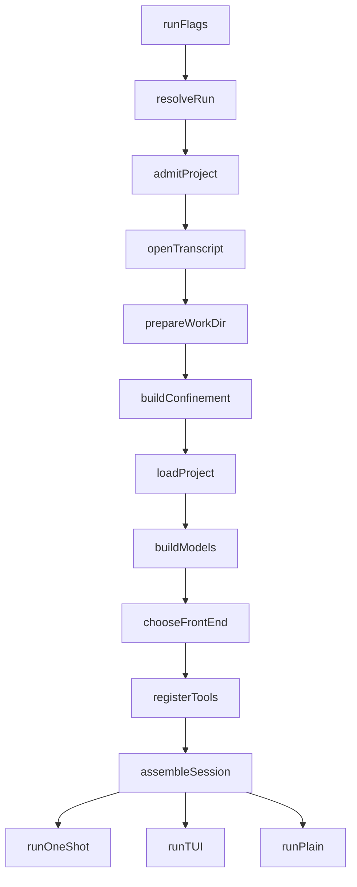

# ADR-0124: the session is assembled from parts — `runREPL` is split without changing what it does

| Field | Value |
|-------|-------|
| Status | **Accepted** (2026-11-18) — implemented (see the addendum) |
| Date | 2026-11-18 |
| Binds | gem-agent |
| Decision makers | nlink-jp maintainers |
| Triggered by | The operator, after the code had grown: is it time to look at the whole and restructure? Measured first; the answer was "not the whole — one function" |
| Relates to | ADR-0005 (resume), ADR-0039 (in-session reload), ADR-0058 (work directory), ADR-0065 §4 (exit flush notice), ADR-0071 (/clear starts a new session), ADR-0073 (lanes), ADR-0074 (pins), ADR-0083 (on-request MCP), ADR-0093 §3 (inert streams), ADR-0099 §12 (grants), CONVENTIONS ADR-029 (design before implementation) |

## Context

### What was measured (v0.108.0, 2026-11-18)

| Measure | Value |
|---|---|
| Non-test Go | 45,166 lines |
| Test Go | 51,232 lines |
| Functions (non-test, excluding `tools/`) | 1,065, of which 9 exceed 150 lines |
| Import cycles between `internal/` packages | none; `agent` and `tui` do not import each other |
| `runREPL` in `cmd/root.go` | **1,893 lines, 255 branches** (if / for / case / && / \|\|) |
| Next largest | `Agent.execCallInner` 351 lines / 51; `tui.Model.Update` 349 / 67; `Agent.Run` 319 / 60 |
| Commits touching each file, last 300 | `cmd/root.go` **94**; `internal/tui/model.go` 46; `internal/agent/agent.go` 44 |

The packages are layered and the rest of the code is in proportion. What is out of proportion is one function, and its file is also the one changed most often. `Agent.Run`, `execCallInner` and `Model.Update` are large because an agent loop and a Bubble Tea update are dispatchers by nature; they change at half the rate and are not this decision's subject.

### What makes `runREPL` hard, beyond its length

1. **Startup order is held by comments.** The session must exist before the work directory (the directory is keyed by its id); the work directory before the lanes (it is a writable root) and before any MCP server (`${GEMAGENT_WORK_DIR}` is expanded at spawn); the instruction files and skills are read before any process the project names starts (ADR-0074: the gap between digest and read); every tool is registered before `agent.New` (declarations are cached there); `inertStreams` runs before the first print (ADR-0093 §3). Each rule is a paragraph inside the function. Moving one block past another compiles and passes the tests.
2. **Twenty locals are written after they are declared** — two late-bound (`prog`, `ag`) and the rest rewritten by the closures that run after startup (`onClear`, `reconnectMCP`, `settings.reloadMCP`, `reloadSkills`, `reportPersistent`): `sessionLog`, `curLog`, `sessionPath`, `sessionID`, `workDir`, `hookSession`, `dates`, `projectContext`, `contextLabels`, `contextNotes` (written by `/clear`, never read after), `skillsList`, `grant.excluded`, `mcpClients`, `mcpSummary`, `mcpInv`, `mcpFilter`, `persistentSnap`, `uiNotes`. What `/clear` changes can only be learned by reading the whole function. `sessionLog` and `curLog` are the same transcript held twice.
3. **Where output goes is decided 13 times.** `if prog != nil { prog.Send(…) } else { fmt.Fprintf(stderr, …) }` appears for notices, tool calls, tool completions, attachments, auto-approval, riskbook output, the agentic search child, hook notices and the context window. The transcript's absence is checked 8 more times, plus 4 `liveLog{…}` literals.
4. **Teardown is 13 `defer`s whose order is behaviour.** At exit the added roots are reported before the project, and both before the session-end hooks, so a change a hook makes shows at the next start; telemetry's `SessionEnd` runs before its `Shutdown`. The order is the reverse of 1,200 lines of registration.
5. **The tests cannot call it, so they copy it or parse it.** `sessions_test.go`'s `resolveAndLoad` "mirrors runREPL's resume flow exactly"; `grant_test.go` builds a granter "as runREPL does"; eight tests (listed in §2.6) read `root.go`'s source because, in `wiring_test.go`'s words, "a behavioral test cannot reach this literal without running the whole REPL". A copy in a test is a second implementation that can agree with itself while the first one changes.
6. **Three copies of the turn start.** The TUI, the plain REPL's skill branch and its plain-turn branch each do `promptStale.Swap(false)` → `SetSystem(composeSystem())` → `ag.Run`. `slashOutput` is called from two places with the same twelve arguments.

### Found while reading (not part of this decision)

1. **A panic on `/clear` (a defect).** When the startup transcript cannot be opened although the state directory resolved, `curLog` stays nil. A later `/clear` that opens its new transcript reports the persistent files through `curLog.Log`, and `(*session.Logger).Log` locks its mutex first: with anything to report, the session panics. Every other transcript write in `runREPL` checks for nil first. It is fixed in its own `fix:` commit, with a test, **before** step 0 — so the restructure, whose transcript holder is nil-safe by construction (§2.3), changes no behaviour.
2. **The exit summary is not always last (the maintainer's call — decided: fixed, see the end of the addendum).** The exit summary is deferred so that it is "the last thing in the scrollback" (its comment, an operator request). With telemetry enabled, the flush notice (ADR-0065 §4) prints after it. Whether that is a defect or an accepted order is the maintainer's call; a change, if any, is its own `fix:` commit, not part of this work.

## Decision

`runREPL` is restructured into parts that can be called and tested on their own. **Nothing the operator, the model, a child process or a log reader can observe changes**: flags, output text and its order, exit codes, transcript records, telemetry events, environment variables, file layout, the startup and exit sequences, and — because the model sees it — the system prompt and the order of the tool declarations. A defect found while doing the work is reported and fixed in its own `fix:` commit, never folded into a `refactor:` one.

### 1. Conceptual design — the parts



| Part | Promise | Does not |
|---|---|---|
| **`runFlags`** | the flag values, read into one struct once at the top of `runREPL` | change how cobra binds them |
| **Startup phases** (`resolveRun` … `assembleSession`) | each takes what it needs from earlier phases **as arguments** and returns a typed result; a phase that needs another's result cannot be called before it | print directly: warnings go to the startup-notes tee as today, in today's order |
| **State holders** | what `/clear` or a reload replaces lives in a holder created by the phase that first produces it — the project grant (its excluded set), the persistent snapshot, the transcript, the work directory, the project content, the MCP set. Whatever was built earlier and must follow a change reads through the holder, as it reads through a closure today | copy values: a holder is shared by pointer |
| **`liveSession`** | owns the holders after startup; the post-startup mutators are its methods; the one place that says what `/clear` changes | add locking: its methods run between turns only — today's single-writer rule, now stated on the type |
| **`surface`** | the one decision of where operator-facing output goes: a TUI surface (late-bound program) and a stream surface (stderr) | decide anything else: what is said stays with the caller |
| **Front ends** (`runOneShot`, `runTUI`, `runPlain`) | each drives the assembled session; all three start a turn through one method, `liveSession.turn` | own any session state |
| **Cleanup stack** | phases push their teardown as they set it up; `runREPL` runs the stack once, last-in first-out — so an early failure undoes only what was done, exactly as the `defer`s it replaces | reorder anything: the exit sequence is pinned by a test |

What stays in `root.go`: `rootCmd`, the flags, `runREPL` itself — now the sequence of phase calls, with `inertStreams` still the first statement after the context is taken, before any print, so `internal/archtest/inert_test.go` (a test lagent shares) reads the same function and passes unchanged — `slashOutput`, and the helpers already there.

**Out of scope.** Moving `cmd/` features into `internal/` packages (21k lines; the churn is in one file, and the other `cmd` files are feature-sized — the largest is `settings.go`, 792 lines); `Agent.Run`, `execCallInner`, `Model.Update`; any behaviour change; lagent (§5).

### 2. Detailed design

#### 2.1 `runFlags` and the package globals

`runFlags` holds the fifteen `flag*` values of the root command; `readFlags()` copies them once. Phases read the struct, never the globals (`askOperator` and the `request_directory` gate read `flagPrompt` directly today; they read `oneShot`, which is the same fact; `resolveAddedDirs` reads `flagAddDir` and `flagReadDir` and takes them as arguments instead). `afterDirectShell`, the package variable `runREPL` sets and clears for `runDirectShell`, becomes a value `runDirectShell` receives from the session. `appVersion` stays (it exists to break an initialization cycle).

#### 2.2 Startup phases

Phases run in this order, which is today's order, so every warning prints where it prints now.

| Phase | Inputs | Output | Fatal (`return err`) as today | Warnings as today |
|---|---|---|---|---|
| `resolveRun` | `runFlags`, args, `getenv` | `runSettings`: cfgPath, cfg, oneShot, interactive, autoOn, ceiling, uiLang, msgs, initialInput, ladder | config load, first message, read-only flags | — |
| `admitProject` | `runSettings`, stdin, stderr | `admission`: projectDir, home, policyFile/Path, trusted, projectCfg, mayLoosen, mcpFilter, approvalPolicy, policyNotes; the **grant holder** (trusted and the excluded set the pin checks rewrite); the **persistent-snapshot holder** | project dir, broad root refused, policy file, project config, MCP filter, `--allow`, policy build | trust note, pin notes, obsolete commands, change-detection cut, changes since the last session |
| `openTranscript` | `runSettings`, `admission` | the **transcript holder**: dir, dirErr, logger, id, path, resumedID, resumedFrom, restored history; `log(kind, data)` is nil-safe | `--continue` with `--resume`, resume resolution, resume append, resume history | log disabled, `GEMAGENT_SESSION` export, resume notes |
| `prepareWorkDir` | `admission`, **transcript** | the **work-directory holder** (dir may be "") | — | `GEMAGENT_PROJECT_DIR` export, unavailable, export, earlier leftovers |
| `buildConfinement` | `runSettings`, `runFlags`, `admission`, transcript, **work directory** | `confinement`: sandboxOn, added, watch, shellExec, enforcement, registry, granter (its log and its work directory read through the holders) | sandbox unavailable, added dirs, lanes, `tools.New`, `AddDirs` | skipped dirs, the added roots' change notes (`newAddedWatch`), lane notes, work directory not readable by the file tools, file child |
| `loadProject` | `admission`, `confinement`, transcript | the **project-content holder** (instructions, labels, skills, memory) and the **MCP-set holder** (advertiser, clients, summary, inventory, filter); registers, in this order, `load_skill`, the MCP servers' tools and the memory tools | those registrations | instruction, skill, MCP, replay, memory notes |
| `buildModels` | `runSettings`, transcript, `loadProject`'s output, `confinement` | `models`: telemetry sink, backend, tally, media upload, summary / risk / librarian slots; registers `summarize_file`, the web tools and, under on-request, the two MCP loading tools | backend creation, those registrations | telemetry disabled |
| `chooseFrontEnd` | `runSettings`, `models` | `frontEnd`: useTUI, the shared stdin reader, images, gate, line reader, `surface`; installs the backend's stream observer | — | — |
| `registerTools` | the above | `toolsRegistered` (an empty value only this function returns); registers `ask_user`, `request_directory` (not under `-p` — the piped plain REPL included, as today), `agent_info`, `agentic_file_search` | each registration | — |
| `assembleSession` | **`toolsRegistered`**, the above | `*liveSession`: hooks, write guard, the agent, restored history, rulebook, riskbook runner, settings store, show-image route, reload methods; pushes the exit steps; runs the session-start hooks | — | risk rules |

The banner and the diagram picture are built by one function, `buildBanner`, called by `runTUI` and `runPlain` at the point they are built today; `runOneShot` does not build them, as today.

Bold inputs are the Context's item 1 turned into arguments: `prepareWorkDir` cannot run without a transcript, `buildConfinement` without a work directory, `assembleSession` without `toolsRegistered`. The one rule that is not a data dependency — instruction files and skills are read before any MCP server spawns — is kept as adjacent statements inside `loadProject` with its comment: a distance of a few lines instead of 1,900.

**Tool registration order is preserved exactly.** The registry's order is the order of the declarations the model receives (and part of the cached request prefix). The phases register in today's order, and the characterization test (§2.6) compares the declarations the model receives.

**The model seam.** The model client is reached through a small interface in `cmd` (`modelClient`: `ChatStream`, `WithModel`, `WithThinking`, `SetObserver`, `SetRetryRecorder`, `ContextWindow`, `Thinking`, `SetThinking`) with an adapter that **embeds** `*llm.Vertex`, so `ChatStream` is promoted rather than forwarded — a forwarding call would be a `.ChatStream(` in `cmd/` without `llm.WithSource`, which `internal/archtest/retrysource_test.go` (ADR-0116 §1) rightly refuses. The adapter overrides only `WithModel` and `WithThinking`, to wrap what they return. `buildModels` takes the constructor as a parameter. This is the one seam the restructure adds — `internal/llm` does not change — and it is what lets a test run the whole startup against a scripted model.

#### 2.3 `liveSession`

Fields: the six holders, the agent, the surface, and the parts built at startup that its methods call into (registry, shellExec, granter, advertiser, sink, settings store, hook runner, hook session, dates). The transcript is held once — `curLog` and `sessionLog` become the holder's one logger.

Methods, each the body of today's closure moved with no edits beyond variable names: `composeSystem`, `turn(ctx, input, out)`, `clear`, `reconnectMCP(recheck)`, `reconnectServer(name)`, `loadMCP(server)`, `reloadSkills`, `sessionStartHooks(source)`, `sessionEndHooks(reason)`, `reportPersistent(reason)`, `resolveWindow`. `slashReloads` and the TUI options are built from the methods. `slashOutput` keeps its body and its case labels, and takes the session in place of the arguments that are session state.

#### 2.4 `surface`

```go
type surface interface {
	notice(msg string)                      // TUI note strip / "[⚠ msg]" on stderr
	hookNotice(msg string)                  // the same, unless a slash command is collecting (below)
	toolCall(name, detail, purpose string)  // "[tool] …" and the purpose line
	childToolCall(name, detail string)      // "[tool ↳] …": the agentic search child
	toolDone(name string)
	attached(lines, notes []string)
	autoApproved(tool, reason, tier string)
	output(lines []string)
	usage(u llm.Usage)
	stream(ev llm.StreamEvent)              // the backend observer; nothing outside the TUI
	contextWindow(tokens int, assumed bool)
	ask(ctx context.Context, q string, opts []string) (int, error)
	collectHookNotices() (stop func() []string) // today's uiNotes
}
```

The TUI surface holds the program, set once before `Run` (today's `prog`), and behaves as the stream surface while it is unset — what the 13 checks do now. The text each branch prints moves with it unchanged. `collectHookNotices` captures what `hookNotice` receives and nothing else — today `uiNotes` is consulted by the hook notifier only, and `notice` (which `/add-dir` uses through the granter) is not collected; that stays so. One-shot `ask` keeps today's `oneShotAsk`.

#### 2.5 The cleanup stack and the exit sequence

`type cleanups []func()`; `push` appends; `run` calls them last-first, once. The exit sequence it must reproduce — today's `defer`s, last registered first:

1. restore the standard logger (TUI only)
2. report the added roots' persistent files (`watch.report("exit")`)
3. report the project's persistent files (`reportPersistent("exit")`)
4. session-end hooks (`"exit"`)
5. exit summary (not one-shot)
6. telemetry `SessionEnd`
7. telemetry flush notice and `Shutdown` (when enabled)
8. close the MCP clients
9. close the skills' roots
10. remove the work directory if empty
11. remove the fallback scratch
12. close the transcript
13. clear the direct-shell hook

#### 2.6 Tests — the judges

| Judge | Written | Checks |
|---|---|---|
| One-shot characterization | step 0, against today's code | `-p` with a scripted model, `--no-sandbox`, a temporary HOME and project: stdout, stderr, exit status, transcript records, **and the system prompt and tool declarations the scripted model received** — byte-equal before and after every step (session ids, dates and paths normalized) |
| Plain-REPL characterization | step 0 | piped stdin: a turn, `/help`, `/usage`, `/clear`, `/skills reload`, `/mcp reload` with an empty `.mcp.json`, EOF — the same comparison, plus the new transcript `/clear` opens |
| Exit sequence | step 1 | the 13 steps of §2.5 in that order on a full run; on a failure in each phase, only the steps already pushed |
| Surface routing | step 2 | each method goes to the program when set and to the stream otherwise; `collectHookNotices` captures hook notices only, and stops capturing |
| `liveSession.clear` | step 3 | new id, transcript, work directory, exported environment, hook session, dates; the old transcript closed and resumable |
| Phase tests | step 4 | each phase on temporary directories; `sessions_test`'s mirror and `grant_test`'s hand-built granter replaced by calls to `openTranscript` and `buildConfinement` |
| Source-reading tests | in the step that moves what they read | eight tests read `root.go`'s source: `wiring_test` (the `tui.Options` literal, step 5), `info_test` (`slashOutput`'s cases), `review3_test` (no second stdin reader), `review4_test` (the `onClear` text, step 3), `ladder_wiring_test` (`runTurnWith` with the ladder, step 5), `retrylog_test` (`recordRetries(backend, …)`, step 4), `pins_recorded_test` (`writes.begin(… repinnable(`, step 4), `archtest/inert_test` (unchanged). Each is retargeted in the step that moves its code, so `go test ./...` stays green at every step: it reads every non-test file in `cmd/` instead of `root.go` alone, and a test that matches a text matches the moved code's text — the same check, never a weaker one |

The TUI cannot be judged by reading source (recorded for ADR-0089/0090: four reviews passed what a real terminal showed broken). It is checked in a real terminal after step 5 — start, a turn, `/clear`, `/mcp reload`, a `/settings` toggle, Ctrl+C at a prompt, `/quit` — and the transcript records compared with the same session on v0.108.0.

### 3. Development plan

| Step | Commit | Done when |
|---|---|---|
| — | `fix:` the `/clear` panic of "Found while reading" 1, with a test | the test fails on today's code and passes after |
| 0 | `test:` the `modelClient` seam and the two characterization tests | they pass on today's code; the recorded output is checked in as the reference |
| 1 | `refactor:` `runFlags`, `afterDirectShell`, the cleanup stack | exit-sequence test passes; characterization unchanged |
| 2 | `refactor:` `surface` | no `prog != nil` in `cmd/` outside the surface; characterization unchanged |
| 3 | `refactor:` the holders, `liveSession` and its methods | the 20 locals exist only on the holders and the session; `clear` test passes |
| 4 | `refactor:` the startup phases | `runREPL` is the sequence of calls; phase tests replace the mirrors |
| 5 | `refactor:` the three front ends and `turn` | one turn-start path; the real-terminal check done |
| 6 | `docs:` AGENTS.md structure; `docs/{en,ja}/reference/architecture.md`; this ADR's addendum | `make check`, `go test ./...` pass |

Every step: `make check` and `go test ./...` green, the characterization tests byte-equal, the source-reading tests for the moved code retargeted in the same commit, one commit. Completion of the whole: `runREPL` under 100 lines; no function in the new files over 150 lines; the Context's measurements taken again and recorded in an addendum here.

The steps are sequential in one session — each builds on the previous step's types. Nothing release-visible changes; whether it ships in its own patch release or with the next change is decided at the end. The CHANGELOG gets one entry; the READMEs are unchanged because nothing an operator uses changed.

### 4. Verification

- **This design**: one independent pass before approval, asked only: does it conflict with the recorded rules (CONVENTIONS, this repository's ADRs and AGENTS.md, the workspace's recorded lessons), and does it leave out something `runREPL` does today? One round; a finding outside that question is recorded as out of scope. **Done 2026-11-18**: eleven findings, all accepted and folded in above — the eight source-reading tests and their retargeting per step, the embedded adapter (ADR-0116's source test), the grant holder, `request_directory` under the piped REPL, the transcript as an input of `buildConfinement`, the `/clear` panic as its own fix, the stream observer and the child's tool line in `surface`, hook-only collection, the missing warnings, the registration order inside `loadProject`, the banner's owner, and the Japanese pair of this record. Its checks that held: the line counts, the 13 output sites, the 8 + 4 transcript sites, the 13-step exit order, today's registration order and its preservation by the phases, the fatal/warning split.
- **The implementation**: judged by conformance to §2 — the characterization tests are the main judge — and one `/code-review` of the whole diff before release. A finding that asks for something §2 does not say is a design change and goes to the maintainer.

### 5. lagent

lagent's `runREPL` has the same shape (1,587 lines, measured 2026-11-18). AGENTS.md's rule ("a defect or a design change in a mechanism both runtimes have is fixed in both") covers the shared mechanisms it lists; `cmd` wiring is not one of them, and this ADR changes no shared package — `internal/archtest/inert_test.go` is kept passing unchanged on purpose. This is a deliberate one-runtime change. Whether lagent takes the same restructure is its owner's decision.

## Alternatives considered

| Alternative | Why not |
|---|---|
| Leave it | The most-changed file is the least readable, and the tests already copy it to reach its behaviour. The cost is paid on every change. |
| Restructure all of `cmd/` or the whole codebase | The measurements do not support it: the packages are layered and one function is out of proportion. A larger change moves more code for no more benefit and raises the chance of an unseen behaviour change. |
| Move the wiring into a new `internal/app` package | `runREPL`'s helpers (`dirGranter`, `settingsStore`, the MCP wiring) are `cmd`'s; moving the function moves them, which is the previous row. |
| A dependency-injection library (wire, fx) | Community tooling is not adopted (supply-chain rule), and plain function arguments enforce the order. |
| A marker type for every ordering rule, instructions-before-MCP included | That rule is not a data dependency; a type for it would be ceremony. Adjacent statements with their comment are the proportionate control. |

## Addendum: the implementation (2026-11-18)

Implemented in seven commits on gem-agent `main`: the `/clear` panic fix (`4a4e88f`), then steps 0–5 (`b795451`, `66b0f32`, `ded4302`, `4000e3a`, `85f87b9`, `27b8c06`) and this record's step 6. Every step kept `make check` green and the characterization references byte-equal; none was rewritten.

### Measured again

| Measure | Before | After |
|---|---|---|
| `runREPL` | 1,893 lines, 255 branches | **67 lines** |
| `cmd/root.go` | 3,193 lines | 1,385 lines (the rest in `startup.go` 1,239, `live.go` 546, `frontends.go` 362, `surface.go` 176, `cleanups.go` 41, `modelclient.go` 52) |
| Largest function in the new files | — | `assembleSession`, 142 lines |
| Functions over 150 lines (non-test, excluding `tools/`) | 9 | 8 — the remaining eight are the ones the Context set aside, plus `slashOutput` (unchanged, 231) |
| `prog != nil` in `cmd/` outside `surface` | 13 | 0 |
| Non-test / test Go | 45,166 / 51,232 | 45,774 / 52,301 |

### Where the implementation differs from §1–§3, and why

1. **The holders are created up front** by `newLiveSession` and filled by the phase that produces their content, instead of being created by that phase. The phases' results passed as arguments hold the order (`prepareWorkDir` takes `opened`, `buildConfinement` the `*workArea`, `assembleSession` the `toolsRegistered` only `registerTools` returns).
2. **`surface` is one concrete type**, not an interface with two implementations: the program is late-bound, so the same value is the stream before it is the TUI.
3. **`slashOutput` keeps its parameters.** Its twenty test call sites hand each command only the parts it needs; the two production calls with the same twelve arguments became `liveSession.slash`.
4. **The exit sequence has twelve steps.** Step 13 of §2.5, clearing the direct-shell hook, is gone with the package variable: `runDirectShell` takes the note as an argument.
5. **The receiver is `sess`**: `s` is a string parameter in a hundred places of the old `runREPL`.
6. **The hooks moved** from between two tool registrations to the head of assembly (`assembleHooks`), as §2.2 placed them; `assembleSession` was further split into `assembleHooks`, `assembleAgent` and the rest to meet the 150-line bound.
7. **§3 left out ADR-0089's and ADR-0090's line citations of `root.go`.** The citation test named them at every step that moved their code; each was retargeted in that step (ADR-0090's to `surface.go`, ADR-0089's to `frontends.go`).

### What judged it

- The two characterization tests of step 0, recorded on `b795451` before any restructure, and a third, recorded on the same commit (exported with `git archive`, not a worktree — gem-agent is a submodule): `/clear` between two `!env` commands with `session_start` and `session_end` hooks, so the environment a child sees and the payloads the hooks get are compared too.
- The exit sequence on a full run (one-shot, plain REPL, TUI) and on a start failing in five different phases, each failing for the reason the case names.
- `liveSession`-level tests replacing the two copies: the resume tests call `openTranscript`, the grant tests build their granter with `buildConfinement`.
- The TUI in a real terminal: the characterization child with its scripted model, run under a private tmux server on `b795451` and on `27b8c06` — start, a turn, `/clear`, `/mcp reload`, the settings panel, a second turn, `/quit`. Transcripts and hook payloads identical; screens differing only in a temporary directory's random name and tmux's dead-pane time. A live Vertex session was not run: what the restructure moved does not reach the model client beyond the seam, and the declarations and prompt the model receives are compared byte for byte.

The implementation-time `/code-review` of §4 runs before the release that ships this, as §4 says.

**"Found while reading" 2, decided.** The maintainer chose to fix it, in its own `fix:` commit: the exit summary runs after every other teardown step, the audit flush and its notice included. With audit logging on, the notice still precedes the wait and the summary is the last line (ADR-0065 addendum).

### The review before release (2026-11-18)

`/code-review` over `v0.108.0..HEAD` returned six findings, all fixed before the release:

1. **`sessionWiringFiles` had fallen behind**: it predated `frontends.go` and left out `modelclient.go`, so the pin-wiring check did not read them. Both are listed, and `TestSessionWiringFilesAreComplete` fails when a file that handles `*liveSession` is missing from the list.
2. **The prompt feeder of the characterization tests could hang**: it signalled prompts on a bounded channel, under its lock, after nobody read it. Signals no longer block.
3. **The references held a machine-dependent line**: the file-read cage's startup note (whether the probe passes here, and its exit status, depend on the machine and the temporary HOME). The note is left out of what is compared; the references changed by exactly that line each, checked before they were replaced.
4. **The transcript holder lacked the nil-safe `log` §2.2 promised**, and the eight nil checks of the Context's item 3 were still there. `transcript.log` is that path now and all eight, and `/clear`'s two reports, go through it; `recordTo`, the fix's one-site guard, is gone. `liveLog` stays: its absent case reports an error to its callers, a different contract.
5. **The exit summary's place was implied by which phase pushed first.** The cleanup stack gained final steps (`pushFinal`), which run after every other step in the order pushed; the summary is one, pushed where the agent is assembled. The exit order is §2.5's with the summary moved to the very end.
6. **The prompt counting rescanned all of stderr on every write**; it scans what was written.

## Addendum: output that did not reach the screen under the TUI (2026-11-19)

lagent's restructure (its ADR-0054) measured what this record left as it was: the TUI's `/clear` lost the note naming the persistent files the session changed. The maintainer decided the TUI must show it. Before fixing, every write that could reach the terminal while the TUI holds the screen, or reach the program after it has ended, was listed in both runtimes. Three were found here. The names follow lagent's record, which found 4 and 5; 6 is this runtime's alone. Each is its own `fix:` commit with a TUI test that fails before it — the TUI is now driven from this repository's tests too (`cmd/tuidrive_test.go`, ported from lagent).

1. **Found 4: `/clear` lost the persistent-file note** (`0433be9`). The project's and the added roots' change reports wrote to the startup stream; under the TUI the next redraw covered the line, which survived only in the transcript. Both reports take their writer per call — `/clear` passes its own output, the exit cleanups the terminal — and `addedWatch` keeps no writer. `TestTUIClearNamesAChangedPersistentFile`.
2. **Found 5: what the exit says after the TUI was lost** (`c7c3b5d`). The surface kept the program after `prog.Run` returned, and Bubble Tea's `Send` to an ended program selects on its cancelled context: a `session_end` hook that failed at exit said nothing on screen or in the scrollback. `runTUI` clears the program when `Run` returns; the field is atomic. `TestTUIExitShowsTheSessionEndHookNotice`.
3. **Found 6: a failing audit-log export garbled the TUI** (`4d5fdbd`). The OTel error handler wrote its once-only warning to `os.Stderr` from the exporter's goroutine: measured under tmux, the line landed on the input row, the next redraw covered it, and the input row and the footer were left run together. `telemetry.New` takes a warn func; the surface's `backgroundWarning` sends a note under the TUI without blocking — the handler also runs inside `/clear`'s flush, in `Update` — and writes the same warning line to the terminal without one. `TestTUITelemetryFailureIsANote`.

**Where this differs from §2.** The surface is built in `buildModels`, ahead of the telemetry exporter whose warnings it routes, not in `chooseFrontEnd` (§2.1's table); `chooseFrontEnd` adds the plain REPL's answer reader. §2.4's "set once before `Run`" is now "set before `Run`, cleared after".

**What else was listed and left.** The MCP reloads and the grant's watch already return their notes; the interrupt ladder writes only outside the TUI; `GEMAGENT_MCP_STDERR=1` hands a server's stderr to the terminal on purpose, as a debugging switch.

### The review before release (2026-11-19)

Two bounded passes, as CONVENTIONS §Verify sets them: one over `v0.108.1..HEAD`, and the fix-diff pass over `90524ba` that v0.108.1 skipped. The latter found nothing: each fix did what its message says. The former found three low findings, and lagent's review of the same restructure (its ADR-0054) found more that hold here; every one was checked against this code.

1. **Two refusal messages were changed by the restructure and shipped in v0.108.1** (medium, from lagent's review): the rewrite of locals into fields reached inside the strings, and `/show` and the model's `show_image` read "cannot draw inline fe.images" and "has no ld.screen". Fixed (`48a7b08`). Every string literal of `cmd` was compared between v0.108.0 and HEAD with a Go parser; these two were the only ones changed. `TestNoStringLiteralNamesAWiringLocal` refuses the class.
2. **The window lookup raced the startup tee** (from lagent's review, present here before 0.108, in one-shot mode too). Fixed (`3a8b0cf`): the tee is locked, and the plain REPL starts the lookup after the banner.
3. **Found 5's fix sent every surface method back to the stream** when the TUI ended. Fixed (`1c8d66d`): `surface.endTUI` lets the exit's notices through and drops the rest.
4. **An export failure during the start was still wiped by the TUI's first clear**, so the CHANGELOG's "now a note in the TUI" did not hold there. Fixed (`1c8d66d`): the warning is kept and replayed; one that reaches the TUI before its first frame joins the banner.
5. **One sent as the program ended was dropped**, and the once-only warning was then spent. Fixed (`1c8d66d`): the TUI acknowledges a `BackgroundNote`, and `endTUI` prints the ones never taken.
6. **The inert-streams order check saw only `runREPL`'s own statements** (from lagent's review). A call handed `cmd` now counts (`04d06fe`).
7. **An unused parameter and a no-op read** (`049e821`).

**What the characterization does not cover**, recorded as the limit of what judged §1–§2 (lagent's review named it; the harness is the same here): every scenario runs unsandboxed, with no MCP server, no resume and no added directory. Those paths were checked by reading and by the resume and grant tests that call the phases, not by comparing output against v0.108.0.

**The fix-diff pass** (the second and last, over `7ffaf47..HEAD`) found nothing high or medium; its low findings were fixed or recorded:

- Fixed: `endTUI` leaves the program set, so a method that read the flag a moment before sends to the ended program instead of the stream, and only the exit's `session_end` hooks and the exporter's warnings speak after the end (`f013402`); a background note raised between the first size report and the first frame's clear waits for the frame (`aec8c1b`); the front ends' order is pinned and the race-only test skips without the race detector (`2b8685f`); `3a8b0cf`'s CHANGELOG entry described lagent — gem-agent's window lookup prints nothing — and is gone (`58d9d46`).
- Accepted and left, with the reason:
  - **The TUI acknowledges a background note when it takes it, before the line is flushed.** A note taken in the milliseconds before the program quits can be lost. It needs the collector's first failure to coincide with the quit, it costs one warning about a collector that is already failing, and closing it would mean reaching into Bubble Tea's flush.
  - **A `prog.Run` that fails before its first frame** leaves a warning written before the TUI on screen, and `endTUI` writes it again: a repeated line on a start that failed anyway.
  - **A structured question asked through the TUI waits on its answer** with no other way out, so a turn left running when the program ends stays blocked. It holds nothing the exit needs, and the process ends with it.
