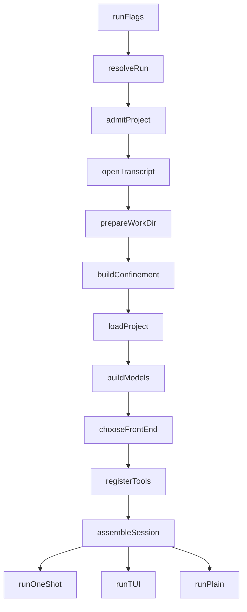

# ADR-0124: セッションは部品から組み立てる — `runREPL` を、することを変えずに分ける

| 項目 | 値 |
|-------|-----|
| Status | **Accepted**（2026-11-18）— 実装済み（追記を参照） |
| Date | 2026-11-18 |
| Binds | gem-agent |
| Decision makers | nlink-jp maintainers |
| Triggered by | コードが大きくなったのを見た操作者の問い: そろそろ全体を見通して作り直すべきではないか。先に測った。答えは「全体ではなく、1 つの関数」 |
| Relates to | ADR-0005（再開）、ADR-0039（セッション中の再読込）、ADR-0058（作業ディレクトリ）、ADR-0065 §4（終了時の送信待ちの知らせ）、ADR-0071（/clear は新しいセッションを始める）、ADR-0073（レーン）、ADR-0074（ピン）、ADR-0083（必要時に読み込む MCP）、ADR-0093 §3（無害化したストリーム）、ADR-0099 §12（許可の追加）、CONVENTIONS ADR-029（実装の前に設計） |

## 背景

### 測ったもの（v0.108.0、2026-11-18）

| 項目 | 値 |
|---|---|
| テスト以外の Go | 45,166 行 |
| テストの Go | 51,232 行 |
| 関数（テスト以外、`tools/` を除く） | 1,065 個。150 行を超えるのは 9 個 |
| `internal/` のパッケージ間の循環 | なし。`agent` と `tui` は互いを import しない |
| `cmd/root.go` の `runREPL` | **1,893 行、分岐 255**（if / for / case / && / \|\|） |
| 次に大きいもの | `Agent.execCallInner` 351 行 / 51、`tui.Model.Update` 349 / 67、`Agent.Run` 319 / 60 |
| 直近 300 コミットで各ファイルを変えた回数 | `cmd/root.go` **94**、`internal/tui/model.go` 46、`internal/agent/agent.go` 44 |

パッケージは層になっていて、ほかのコードは釣り合っている。釣り合っていないのは 1 つの関数で、そのファイルがいちばんよく変わるファイルでもある。`Agent.Run`・`execCallInner`・`Model.Update` が大きいのは、エージェントのループと Bubble Tea の Update がもともと振り分け役だからだ。変わる頻度は半分で、この決定の対象ではない。

### `runREPL` が長さ以上に扱いにくい理由

1. **起動の順序をコメントだけが守っている。** セッションは作業ディレクトリより先にできていなければならない（ディレクトリ名がセッション id だから）。作業ディレクトリはレーンより先（書き込める場所の 1 つだから）で、どの MCP サーバより先（`${GEMAGENT_WORK_DIR}` は起動時に展開されるから）。指示ファイルとスキルは、プロジェクトが名指すプロセスが起動する前に読む（ADR-0074: 要約を取ってから読むまでの間を短く保つ）。ツールはすべて `agent.New` より先に登録する（宣言がそこで固定されるから）。`inertStreams` は最初の出力より前に呼ぶ（ADR-0093 §3）。どの決まりも関数の中の 1 段落でしかない。あるブロックを別のブロックの後ろへ動かしても、コンパイルは通り、テストも通る。
2. **宣言の後で書き換わる局所変数が 20 個ある。** 2 個は後から決まるもの（`prog`、`ag`）、残りは起動後に動くクロージャ（`onClear`、`reconnectMCP`、`settings.reloadMCP`、`reloadSkills`、`reportPersistent`）が書き換える: `sessionLog`、`curLog`、`sessionPath`、`sessionID`、`workDir`、`hookSession`、`dates`、`projectContext`、`contextLabels`、`contextNotes`（`/clear` が書くが、その後は読まれない）、`skillsList`、`grant.excluded`、`mcpClients`、`mcpSummary`、`mcpInv`、`mcpFilter`、`persistentSnap`、`uiNotes`。`/clear` が何を変えるかは、関数全体を読まないと分からない。`sessionLog` と `curLog` は同じ記録ファイルを 2 回持っている。
3. **出力の行き先を 13 か所で決めている。** `if prog != nil { prog.Send(…) } else { fmt.Fprintf(stderr, …) }` が、知らせ、ツール呼び出し、ツールの完了、添付、自動承認、riskbook の出力、委任検索の子、フックの知らせ、コンテキストの窓について出てくる。記録ファイルが無い場合の確認がさらに 8 か所、`liveLog{…}` が 4 か所ある。
4. **後片づけは 13 個の `defer` で、その順序が振る舞いそのもの。** 終了時は、追加ルートの報告がプロジェクトの報告より先で、どちらもセッション終了フックより先に動く。だから、フックが加えた変更は次の起動時に報告される。テレメトリの `SessionEnd` は `Shutdown` より先。この順序は、1,200 行にわたる登録の逆順として決まっている。
5. **テストはこの関数を呼べないので、写すか、ソースを読むかしている。** `sessions_test.go` の `resolveAndLoad` は「runREPL の再開の流れをそのまま写したもの」。`grant_test.go` は「runREPL と同じように」granter を組み立てる。8 本のテスト（§2.6 に一覧）は `root.go` のソースを読む。`wiring_test.go` の言葉では「振る舞いのテストは、REPL 全体を動かさないとこのリテラルに届かない」からだ。テストの中の写しは 2 つ目の実装で、本物が変わっても写しどうしで一致し続けてしまう。
6. **ターン開始の処理が 3 つある。** TUI、素の REPL のスキル分岐、素の REPL の通常分岐が、それぞれ `promptStale.Swap(false)` → `SetSystem(composeSystem())` → `ag.Run` を行う。`slashOutput` は 2 か所から、同じ 12 個の引数で呼ばれる。

### 読んでいて見つけたもの（この決定には含めない）

1. **`/clear` での panic（不具合）。** 状態ディレクトリは決まったのに起動時の記録ファイルが開けなかったとき、`curLog` は nil のまま残る。その後の `/clear` が新しい記録ファイルを開くと、永続ファイルの報告を `curLog.Log` で書こうとする。`(*session.Logger).Log` は最初にロックを取るので、報告することがあればセッションは panic する。`runREPL` のほかの記録の書き込みは、どれも先に nil を確かめている。これは独立した `fix:` コミットで、テストつきで、手順 0 **より前に**直す。そうすれば、記録ファイルの保持役が作りの上で nil に強い（§2.3）作り直しは、振る舞いを何も変えない。
2. **終了の要約がいつも最後とは限らない（保守者の判断）。** 終了の要約は「スクロールバックの最後に出る」ように defer されている（そのコメント、操作者の要望）。テレメトリが有効だと、送信待ちの知らせ（ADR-0065 §4）がその後に出る。これが不具合か、受け入れた順序かは保守者が決める。変えるなら独立した `fix:` コミットで、この作業には含めない。

## 決定

`runREPL` を、単独で呼べてテストできる部品に作り直す。**操作者・モデル・子プロセス・記録の読み手から見えるものは何も変えない**: フラグ、出力の文言とその順序、終了コード、記録ファイルのレコード、テレメトリのイベント、環境変数、ファイルの配置、起動と終了の手順、そしてモデルが見るので、システムプロンプトとツール宣言の順序。作業中に見つけた不具合は報告し、独立した `fix:` コミットで直す。`refactor:` コミットに混ぜない。

### 1. 概念設計 — 部品



| 部品 | 約束すること | しないこと |
|---|---|---|
| **`runFlags`** | フラグの値を、`runREPL` の先頭で 1 回だけ 1 つの構造体に読み込む | cobra への結び付け方を変える |
| **起動の段**（`resolveRun` … `assembleSession`） | それぞれ、前の段から要るものを**引数で**受け取り、型のある結果を返す。別の段の結果が要る段は、その段より前には呼べない | 直接出力する: 警告は今と同じく起動時の控えに、今と同じ順で入れる |
| **状態の保持役** | `/clear` や再読込が差し替えるものは、最初にそれを作る段が作った保持役に置く — プロジェクトの許可（除外の集合）、永続ファイルの控え、記録ファイル、作業ディレクトリ、プロジェクトの中身、MCP の一式。先に作られていて変更に追随すべきものは、今クロージャ越しに読んでいるのと同じく、保持役越しに読む | 値を写す: 保持役はポインタで共有する |
| **`liveSession`** | 起動後の保持役を持つ。起動後に状態を変える処理はそのメソッドになる。`/clear` が何を変えるかを言う唯一の場所 | ロックを足す: メソッドはターンの合間にしか動かない。今の「書き手は 1 人」の決まりを、型の上に書くだけ |
| **`surface`** | 操作者に向けた出力の行き先を 1 か所で決める: TUI 用（プログラムは後から決まる）と、ストリーム用（stderr） | それ以外を決める: 何を言うかは呼び出し側に残る |
| **入口**（`runOneShot`、`runTUI`、`runPlain`） | 組み立てたセッションを動かす。3 つとも、ターンは 1 つのメソッド `liveSession.turn` で始める | セッションの状態を持つ |
| **後片づけの積み上げ** | 段は、用意したものの後片づけをその場で積む。`runREPL` は最後に積んだものから 1 回だけ実行する。途中で失敗したときは用意できたものだけを片づける — 置き換える `defer` と同じ | 順序を変える: 終了の手順はテストで固定する |

`root.go` に残るもの: `rootCmd`、フラグ、`runREPL` そのもの（段の呼び出しを並べたものになる。`inertStreams` は、コンテキストを取った直後、どの出力よりも前に呼ぶまま。だから `internal/archtest/inert_test.go`（lagent と共有するテスト）は同じ関数を読み、変更なしで通る）、`slashOutput`、すでにある補助関数。

**範囲外。** `cmd/` の機能を `internal/` のパッケージへ移すこと（2 万 1 千行。変更は 1 ファイルに集まっていて、ほかの `cmd` のファイルは機能ひとつ分の大きさ。最大でも `settings.go` の 792 行）。`Agent.Run`・`execCallInner`・`Model.Update`。振る舞いの変更。lagent（§5）。

### 2. 詳細設計

#### 2.1 `runFlags` とパッケージ変数

`runFlags` はルートコマンドの 15 個の `flag*` の値を持ち、`readFlags()` が 1 回だけ写す。段は構造体を読み、パッケージ変数は読まない（今は `askOperator` と `request_directory` の判定が `flagPrompt` を直接読んでいるが、同じ事実である `oneShot` を読むようにする。`resolveAddedDirs` は `flagAddDir` と `flagReadDir` を読んでいるが、引数で受け取るようにする）。`runREPL` が `runDirectShell` のために設定して消すパッケージ変数 `afterDirectShell` は、`runDirectShell` がセッションから受け取る値にする。`appVersion` は残す（初期化の循環を断つためにある）。

#### 2.2 起動の段

段は次の順で動く。これは今の順序なので、どの警告も今と同じところに出る。

| 段 | 入力 | 出力 | 今と同じく致命的（`return err`） | 今と同じく警告 |
|---|---|---|---|---|
| `resolveRun` | `runFlags`、引数、`getenv` | `runSettings`: cfgPath、cfg、oneShot、interactive、autoOn、ceiling、uiLang、msgs、initialInput、ladder | 設定の読み込み、最初のメッセージ、読み取り専用のフラグ | — |
| `admitProject` | `runSettings`、stdin、stderr | `admission`: projectDir、home、policyFile/Path、trusted、projectCfg、mayLoosen、mcpFilter、approvalPolicy、policyNotes。**許可の保持役**（trusted と、ピンの確認が書き換える除外の集合）。**永続ファイルの控えの保持役** | プロジェクトのディレクトリ、広すぎるルートの拒否、ポリシーファイル、プロジェクトの設定、MCP の除外、`--allow`、ポリシーの組み立て | 信頼の知らせ、ピンの知らせ、使われない commands、変更検出の打ち切り、前回のセッションからの変更 |
| `openTranscript` | `runSettings`、`admission` | **記録ファイルの保持役**: dir、dirErr、logger、id、path、resumedID、resumedFrom、復元した履歴。`log(kind, data)` は nil に強い | `--continue` と `--resume` の併用、再開先の解決、再開先への追記、再開する履歴 | 記録の無効化、`GEMAGENT_SESSION` の設定、再開の知らせ |
| `prepareWorkDir` | `admission`、**記録ファイル** | **作業ディレクトリの保持役**（dir は "" のこともある） | — | `GEMAGENT_PROJECT_DIR` の設定、使えない、設定、以前の残り |
| `buildConfinement` | `runSettings`、`runFlags`、`admission`、記録ファイル、**作業ディレクトリ** | `confinement`: sandboxOn、added、watch、shellExec、enforcement、registry、granter（その記録と作業ディレクトリは保持役越しに読む） | サンドボックスが使えない、追加ディレクトリ、レーン、`tools.New`、`AddDirs` | 除いたディレクトリ、追加ルートの変更の知らせ（`newAddedWatch`）、レーンの知らせ、作業ディレクトリをファイルツールが読めない、ファイル読み取りの子 |
| `loadProject` | `admission`、`confinement`、記録ファイル | **プロジェクトの中身の保持役**（指示、ラベル、スキル、メモリ）と **MCP 一式の保持役**（advertiser、clients、summary、inventory、filter）。登録は `load_skill`、MCP サーバのツール、メモリのツールの順 | それらの登録 | 指示、スキル、MCP、再現、メモリの知らせ |
| `buildModels` | `runSettings`、記録ファイル、`loadProject` の出力、`confinement` | `models`: テレメトリ、バックエンド、集計、メディアのアップロード、要約 / リスク / 司書の枠。`summarize_file`、Web ツール、必要時読み込みのときは MCP を読み込む 2 つのツールを登録 | バックエンドの作成、それらの登録 | テレメトリの無効化 |
| `chooseFrontEnd` | `runSettings`、`models` | `frontEnd`: useTUI、共有の stdin リーダ、画像、承認の門、行リーダ、`surface`。バックエンドのストリーム観測を取り付ける | — | — |
| `registerTools` | ここまでのもの | `toolsRegistered`（この関数だけが返す空の値）。`ask_user`、`request_directory`（`-p` のときは登録しない。パイプで動く素の REPL では今と同じく登録する）、`agent_info`、`agentic_file_search` を登録 | それぞれの登録 | — |
| `assembleSession` | **`toolsRegistered`**、ここまでのもの | `*liveSession`: フック、書き込みの見張り、エージェント、復元した履歴、ルールブック、riskbook の実行役、設定の保管、画像表示の経路、再読込のメソッド。終了の手順を積み、セッション開始フックを動かす | — | リスクのルール |

バナーと図の描画設定は、1 つの関数 `buildBanner` が作る。`runTUI` と `runPlain` が、今それを作っている時点で呼ぶ。`runOneShot` は今と同じく作らない。

太字の入力は、背景の 1 を引数に変えたものだ。`prepareWorkDir` は記録ファイルが無いと呼べず、`buildConfinement` は作業ディレクトリが無いと呼べず、`assembleSession` は `toolsRegistered` が無いと呼べない。データの依存ではない決まりが 1 つだけある。指示ファイルとスキルは、どの MCP サーバの起動よりも先に読む、というものだ。これは `loadProject` の中で隣り合う文として、コメントごと残す。1,900 行の距離が数行になる。

**ツールの登録順は正確に保つ。** 登録の順は、モデルが受け取る宣言の順そのもので、キャッシュされるリクエストの先頭部分にも含まれる。段は今の順で登録し、特性テスト（§2.6）がモデルの受け取った宣言を比べる。

**モデルの差し替え口。** モデルのクライアントには、`cmd` の中の小さなインターフェース（`modelClient`: `ChatStream`、`WithModel`、`WithThinking`、`SetObserver`、`SetRetryRecorder`、`ContextWindow`、`Thinking`、`SetThinking`）を通して届く。アダプタは `*llm.Vertex` を**埋め込む**ので、`ChatStream` は転送ではなく昇格になる。転送すると `cmd/` に `llm.WithSource` の無い `.ChatStream(` が生まれ、`internal/archtest/retrysource_test.go`（ADR-0116 §1）が正しく拒む。アダプタが上書きするのは、返り値を包むための `WithModel` と `WithThinking` だけ。`buildModels` はコンストラクタを引数で受け取る。作り直しで足す差し替え口はこれ 1 つで、`internal/llm` は変えない。これがあるので、テストが台本どおりに答えるモデルで起動全体を動かせる。

#### 2.3 `liveSession`

フィールド: 6 つの保持役、エージェント、surface、メソッドが呼ぶ起動時に作った部品（registry、shellExec、granter、advertiser、テレメトリ、設定の保管、フックの実行役、フックに渡すセッション情報、日付）。記録ファイルは 1 回だけ持つ。`curLog` と `sessionLog` は、保持役の 1 つの logger になる。

メソッドは、今のクロージャの本体を、変数名以外は手を入れずに移したもの: `composeSystem`、`turn(ctx, input, out)`、`clear`、`reconnectMCP(recheck)`、`reconnectServer(name)`、`loadMCP(server)`、`reloadSkills`、`sessionStartHooks(source)`、`sessionEndHooks(reason)`、`reportPersistent(reason)`、`resolveWindow`。`slashReloads` と TUI のオプションはメソッドから作る。`slashOutput` は本体と case のラベルを変えず、セッションの状態にあたる引数の代わりにセッションを受け取る。

#### 2.4 `surface`

```go
type surface interface {
	notice(msg string)                      // TUI の知らせ欄 / stderr に "[⚠ msg]"
	hookNotice(msg string)                  // 同じ。ただしスラッシュコマンドが集めている間は除く（下記）
	toolCall(name, detail, purpose string)  // "[tool] …" と目的の行
	childToolCall(name, detail string)      // "[tool ↳] …": 委任検索の子
	toolDone(name string)
	attached(lines, notes []string)
	autoApproved(tool, reason, tier string)
	output(lines []string)
	usage(u llm.Usage)
	stream(ev llm.StreamEvent)              // バックエンドの観測。TUI 以外では何もしない
	contextWindow(tokens int, assumed bool)
	ask(ctx context.Context, q string, opts []string) (int, error)
	collectHookNotices() (stop func() []string) // 今の uiNotes
}
```

TUI 用は、`Run` の前に 1 回だけ設定するプログラム（今の `prog`）を持ち、設定されるまではストリーム用と同じに振る舞う。今の 13 か所の確認がしていることと同じだ。各分岐が出す文言は、そのまま一緒に移す。`collectHookNotices` が集めるのは `hookNotice` に来たものだけ。今 `uiNotes` を見るのはフックの知らせだけで、`notice`（`/add-dir` が granter 越しに使う）は集めない。これは変えない。1 回実行（`-p`）の `ask` は今の `oneShotAsk` のまま。

#### 2.5 後片づけの積み上げと終了の手順

`type cleanups []func()`。`push` で積み、`run` で最後に積んだものから 1 回だけ呼ぶ。再現しなければならない終了の手順（今の `defer` を、最後に登録したものから並べたもの）:

1. 標準ロガーを戻す（TUI のみ）
2. 追加ルートの永続ファイルを報告する（`watch.report("exit")`）
3. プロジェクトの永続ファイルを報告する（`reportPersistent("exit")`）
4. セッション終了フック（`"exit"`）
5. 終了の要約（1 回実行を除く）
6. テレメトリの `SessionEnd`
7. テレメトリの送信待ちの知らせと `Shutdown`（有効なとき）
8. MCP クライアントを閉じる
9. スキルのルートを閉じる
10. 作業ディレクトリが空なら消す
11. 予備の一時領域を消す
12. 記録ファイルを閉じる
13. 直接シェルのフックを外す

#### 2.6 テスト — 判定役

| 判定役 | 書く時期 | 確かめること |
|---|---|---|
| 1 回実行の特性テスト | 手順 0、今のコードに対して | `-p`、台本どおりに答えるモデル、`--no-sandbox`、一時的な HOME とプロジェクト: stdout、stderr、終了コード、記録ファイルのレコード、**そして台本のモデルが受け取ったシステムプロンプトとツール宣言** — どの手順の前後でもバイト単位で一致（セッション id・日付・パスは正規化） |
| 素の REPL の特性テスト | 手順 0 | パイプの stdin: 1 ターン、`/help`、`/usage`、`/clear`、`/skills reload`、空の `.mcp.json` での `/mcp reload`、EOF — 同じ比較に加え、`/clear` が開く新しい記録ファイル |
| 終了の手順 | 手順 1 | 全体を動かしたとき §2.5 の 13 手がその順で動く。各段で失敗させたときは、それまでに積んだ手だけが動く |
| 出力の行き先 | 手順 2 | プログラムが設定されていればプログラムへ、されていなければストリームへ。`collectHookNotices` はフックの知らせだけを集め、止めれば集めなくなる |
| `liveSession.clear` | 手順 3 | 新しい id、記録ファイル、作業ディレクトリ、設定される環境変数、フックに渡す情報、日付。古い記録ファイルは閉じられ、再開できる |
| 段のテスト | 手順 4 | 各段を一時ディレクトリで動かす。`sessions_test` の写しと `grant_test` の手組みの granter は、`openTranscript` と `buildConfinement` の呼び出しに置き換える |
| ソースを読むテスト | 読んでいるコードを動かす手順で | `root.go` のソースを読むテストは 8 本: `wiring_test`（`tui.Options` のリテラル、手順 5）、`info_test`（`slashOutput` の case）、`review3_test`（2 つ目の stdin リーダが無いこと）、`review4_test`（`onClear` の文字列、手順 3）、`ladder_wiring_test`（ladder つきの `runTurnWith`、手順 5）、`retrylog_test`（`recordRetries(backend, …)`、手順 4）、`pins_recorded_test`（`writes.begin(… repinnable(`、手順 4）、`archtest/inert_test`（変えない）。どれも、そのコードを動かす手順の中で向け直すので、`go test ./...` はどの手順でも通る。読む対象を `root.go` だけから `cmd/` のテスト以外の全ファイルに広げ、文字列を照合するテストは移した先のコードの文字列を照合する — 同じ確認で、弱めることはしない |

TUI はソースを読んでも判定できない（ADR-0089/0090 で記録済み: 4 回のレビューが通したものを、実際の端末は壊れていると示した）。手順 5 の後に実際の端末で確かめる — 起動、1 ターン、`/clear`、`/mcp reload`、`/settings` の切り替え、プロンプトでの Ctrl+C、`/quit` — そして記録ファイルのレコードを、v0.108.0 での同じセッションと比べる。

### 3. 開発計画

| 手順 | コミット | 完了の条件 |
|---|---|---|
| — | `fix:` 「読んでいて見つけたもの」1 の `/clear` での panic を、テストつきで | テストが今のコードで失敗し、直した後に通る |
| 0 | `test:` `modelClient` の差し替え口と 2 つの特性テスト | 今のコードで通る。記録した出力を基準としてコミットする |
| 1 | `refactor:` `runFlags`、`afterDirectShell`、後片づけの積み上げ | 終了の手順のテストが通る。特性テストは変わらない |
| 2 | `refactor:` `surface` | `cmd/` の中で surface の外に `prog != nil` が残らない。特性テストは変わらない |
| 3 | `refactor:` 保持役、`liveSession` とそのメソッド | 20 個の局所変数は保持役とセッションの上にだけある。`clear` のテストが通る |
| 4 | `refactor:` 起動の段 | `runREPL` は呼び出しを並べたものになる。段のテストが写しを置き換える |
| 5 | `refactor:` 3 つの入口と `turn` | ターン開始の道が 1 つになる。実際の端末での確認を済ませる |
| 6 | `docs:` AGENTS.md の構成、`docs/{en,ja}/reference/architecture.md`、この ADR の追記 | `make check`、`go test ./...` が通る |

どの手順でも: `make check` と `go test ./...` が通り、特性テストがバイト単位で一致し、動かしたコードを読むテストを同じコミットで向け直し、1 コミットにする。全体の完了: `runREPL` が 100 行未満。新しいファイルに 150 行を超える関数が無い。背景の表の値を測り直し、ここに追記する。

手順は 1 つのセッションで順に進める。どの手順も、前の手順で作った型の上に立つからだ。リリースで見える変化は無い。単独のパッチリリースで出すか、次の変更と一緒に出すかは最後に決める。CHANGELOG には 1 項目を足す。操作者が使うものは何も変わらないので、README は変えない。

### 4. 検証

- **この設計**: 承認の前に独立した検証を 1 回だけかける。問いは 2 つだけ: 記録済みの規則（CONVENTIONS、このリポジトリの ADR と AGENTS.md、ワークスペースに記録した教訓）と食い違うか。今の `runREPL` がしていることで、設計から漏れているものはあるか。1 巡で終える。問いの外の所見は範囲外として記録する。**2026-11-18 に実施**: 所見 11 件をすべて採用し、上に反映した — ソースを読む 8 本のテストと手順ごとの向け直し、埋め込みのアダプタ（ADR-0116 の出所テスト）、許可の保持役、パイプで動く REPL での `request_directory`、`buildConfinement` の入力としての記録ファイル、独立した修正としての `/clear` での panic、`surface` のストリーム観測と子のツール行、フックだけを集めること、抜けていた警告、`loadProject` の中の登録順、バナーの持ち主、この記録の日本語版。正しいと確かめられたもの: 行数、13 か所の出力、8 + 4 か所の記録、13 手の終了順、今の登録順とそれを段が保つこと、致命と警告の分け方。
- **実装**: §2 への適合で判定する。主な判定役は特性テスト。リリースの前に差分全体へ `/code-review` を 1 回かける。§2 に書いていないことを求める所見は設計の変更なので、保守者に出す。

### 5. lagent

lagent の `runREPL` も同じ形をしている（1,587 行、2026-11-18 に測定）。AGENTS.md の決まり（「両方のランタイムが持つ仕組みの不具合や設計変更は、両方で直す」）が対象にするのは、そこに挙げた共有の仕組みで、`cmd` の組み立てはその中に入っていない。この ADR は共有のパッケージを何も変えない。`internal/archtest/inert_test.go` は、意図して変更なしで通るようにしてある。これは意図した片方だけの変更だ。lagent が同じ作り直しをするかは、lagent の持ち主が決める。

## 検討した代替案

| 代替案 | 採らない理由 |
|---|---|
| そのままにする | いちばんよく変わるファイルがいちばん読みにくく、テストはすでに振る舞いに届くためにそれを写している。代償は変更のたびに払う。 |
| `cmd/` 全体、またはコード全体を作り直す | 測った値が支持しない: パッケージは層になっていて、釣り合っていないのは 1 つの関数だ。大きな変更は、得るものが増えないまま動かすコードを増やし、見えない振る舞いの変化を招きやすくする。 |
| 組み立てを新しい `internal/app` パッケージに移す | `runREPL` の補助（`dirGranter`、`settingsStore`、MCP の組み立て）は `cmd` のもので、関数を移せばそれらも移る。それは前の行と同じだ。 |
| 依存性注入のライブラリ（wire、fx） | コミュニティ製のツールは採らない（サプライチェーンの決まり）。順序は普通の関数の引数で守れる。 |
| 順序の決まりすべてに印の型を作る（指示ファイルを MCP より先に読むことも含めて） | その決まりはデータの依存ではない。そのための型は形式だけのものになる。隣り合う文とそのコメントで釣り合う。 |

## 追記: 実装（2026-11-18）

gem-agent の `main` に 7 コミットで実装した。`/clear` での panic の修正（`4a4e88f`）、手順 0〜5（`b795451`、`66b0f32`、`ded4302`、`4000e3a`、`85f87b9`、`27b8c06`）、そしてこの記録の手順 6。どの手順でも `make check` が通り、特性テストの基準はバイト単位で一致し続けた。基準は一度も書き換えていない。

### 測り直した値

| 項目 | 前 | 後 |
|---|---|---|
| `runREPL` | 1,893 行、分岐 255 | **67 行** |
| `cmd/root.go` | 3,193 行 | 1,385 行（残りは `startup.go` 1,239、`live.go` 546、`frontends.go` 362、`surface.go` 176、`cleanups.go` 41、`modelclient.go` 52） |
| 新しいファイルで最大の関数 | — | `assembleSession`、142 行 |
| 150 行を超える関数（テスト以外、`tools/` を除く） | 9 | 8 — 残る 8 個は背景で対象外とした関数と、`slashOutput`（変えていない、231 行） |
| `cmd/` の中で `surface` の外にある `prog != nil` | 13 | 0 |
| テスト以外 / テストの Go | 45,166 / 51,232 | 45,774 / 52,301 |

### §1〜§3 と違うところと、その理由

1. **保持役は最初に作る。** `newLiveSession` が作り、中身はそれを生む段が入れる。その段が作るのではない。順序は引数として渡す段の結果が守る（`prepareWorkDir` は `opened` を、`buildConfinement` は `*workArea` を、`assembleSession` は `registerTools` だけが返す `toolsRegistered` を受け取る）。
2. **`surface` は 1 つの具体的な型にした。** 2 つの実装を持つインターフェースにはしていない。プログラムは後から決まるので、同じ値がまずストリーム用で、後で TUI 用になる。
3. **`slashOutput` は引数を変えなかった。** テストの 20 か所の呼び出しが、各コマンドに要る部品だけを渡している。本番で同じ 12 個の引数を渡していた 2 か所は `liveSession.slash` にした。
4. **終了の手順は 12 手になった。** §2.5 の 13 手目（直接シェルのフックを外す）は、パッケージ変数と一緒に無くなった。`runDirectShell` は知らせを引数で受け取る。
5. **受け手の名前は `sess`。** 旧 `runREPL` では `s` が 100 か所ほど文字列の引数として使われている。
6. **フックは移した。** 2 つのツール登録の間から、組み立ての先頭（`assembleHooks`）へ。§2.2 の置き場所どおり。150 行の上限を守るため、`assembleSession` はさらに `assembleHooks`・`assembleAgent`・残りに分けた。
7. **§3 は ADR-0089 と ADR-0090 の `root.go` の行番号の引用を落としていた。** 引用テストが、そのコードを動かした手順ごとに名指しした。どれもその手順の中で向け直した（ADR-0090 は `surface.go` へ、ADR-0089 は `frontends.go` へ）。

### 何で判定したか

- 手順 0 の 2 つの特性テスト。作り直しの前に `b795451` で記録した。3 つ目も同じコミットで記録した（submodule なので worktree ではなく `git archive` で書き出した）。`session_start` と `session_end` のフックを設定し、2 回の `!env` の間で `/clear` を打つので、子プロセスに見える環境とフックが受け取る情報も比べる。
- 全体を動かしたときの終了の手順（1 回実行・素の REPL・TUI）と、5 つの別々の段で起動を失敗させたときの終了の手順。どの場合も、意図した理由で失敗することも確かめる。
- 2 つの写しを置き換えたテスト。再開のテストは `openTranscript` を呼び、granter のテストは `buildConfinement` で granter を作る。
- 実際の端末での TUI。台本どおりに答えるモデルを持つ特性テストの子プロセスを、専用の tmux サーバの中で `b795451` と `27b8c06` の両方で動かした — 起動、1 ターン、`/clear`、`/mcp reload`、設定パネル、2 ターン目、`/quit`。記録ファイルとフックの受け取る情報は同一。画面の違いは一時ディレクトリの乱数名と、tmux の終了時刻だけ。本物の Vertex のセッションは動かしていない。作り直しで動かしたものは、差し替え口より先のモデルクライアントには届かず、モデルが受け取る宣言とプロンプトはバイト単位で比べている。

§4 の実装時の `/code-review` は、§4 のとおり、これを出すリリースの前にかける。「読んでいて見つけたもの」2（終了の要約の位置）は、引き続き保守者の判断を待つ。
